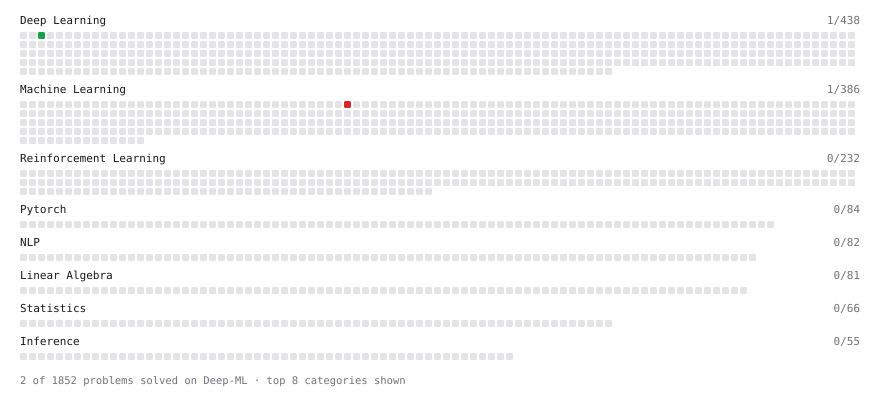

# Deep-ML

My machine learning practice from [Deep-ML](https://www.deep-ml.com). Every solution here was written by hand.

**2** solved · 2 problems · 0 labs · 0 math

[**Browse the interactive portfolio**](https://Kevin11Kaikai.github.io/deep-ml/) to replay this filling in over time.

## Problems

| | Difficulty | Solved | |
| --- | --- | --- | --- |
| [Single Neuron](https://www.deep-ml.com/problems/24) | easy | 2026-10-29 | [solution](problems/0024-single-neuron) |
| [Train Logistic Regression with Gradient Descent](https://www.deep-ml.com/problems/106) | hard | 2026-10-30 | [solution](problems/0106-train-logistic-regression-with-gradient-descent) |

---

_This file is regenerated by Deep-ML on every push._
